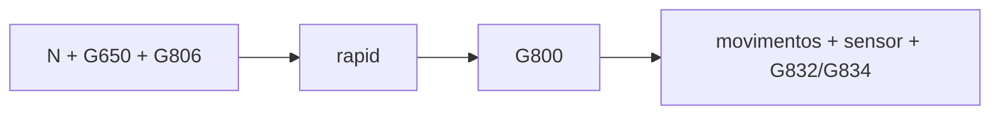

# glorystarContour

## Visão geral

Escreve um contorno de um programa GloryStar. Interno.

## Responsabilidades

- Escrever seleção de deslocamento, rapid com cabeça levantada quando necessário e o início de corte `G800`.
- Escrever retas `G1` e arcos `G2`/`G3` com centro absoluto, quebrados nos quadrantes (arcos de até 2 graus viram retas).
- Escrever `G832` ao sair do lead-in e `G834 W` para alumínio e inox grossos.
- Escrever as palavras do sensor de altura só quando o estado muda.

## Entradas e saídas

```ts
export function emitGlorystarContour(contour: Contour, index: number, context: GlorystarContourContext): readonly ValidationIssue[]
```

## Fluxo principal



## Tratamento de erros e casos-limite

Qualidade ausente gera `PROCESS_SETTING_REQUIRED`. A qualidade 3 usa regulador 0 e não escreve palavras do sensor.

## Exemplos

```ts
emitGlorystarContour(contour, 0, { writer, mapPoint, format, settings, dialect, headUp: true })
```

## Dependências e integrações

`../splitArcAtQuadrants`, `../arcSweep`, `./glorystarQuality`.
