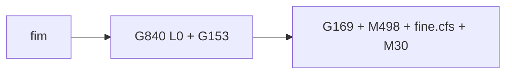

# glorystarEnding

## Visão geral

Encerramento de um programa GloryStar. Interno.

## Responsabilidades

- Recolher a cabeça, fechar a trilha e encerrar o programa.

## Entradas e saídas

```ts
export function glorystarEnding(): string[]
```

## Fluxo principal



## Tratamento de erros e casos-limite

Sem parâmetros.

## Exemplos

```ts
glorystarEnding()[5] // 'M30'
```

## Dependências e integrações

Nenhuma.
