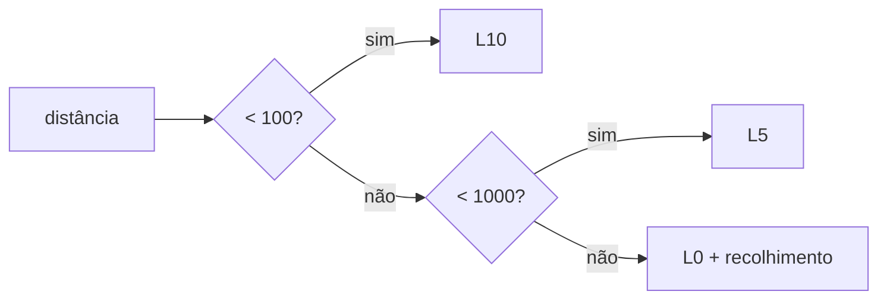

# glorystarFlameOff

## Visão geral

Escolhe o desligamento da chama entre dois contornos pela distância do deslocamento. Interno ao dialeto da GloryStar.

## Responsabilidades

- Manter a cabeça baixa (`G840 L10`) abaixo do limite de cabeça baixa.
- Saltar (`G840 L5`) abaixo do limite de salto.
- Levantar a cabeça (`G840 L0` com recolhimento) acima dele.

## Entradas e saídas

```ts
export function glorystarFlameOff(travel: number | undefined, dialect: { headDownMaxDistance: number; jumpMaxDistance: number }): { lines: string[]; headUp: boolean }
```

## Fluxo principal



## Tratamento de erros e casos-limite

Após o último contorno nada é escrito: o encerramento recolhe a cabeça. Os limites são exclusivos.

## Exemplos

```ts
glorystarFlameOff(50, { headDownMaxDistance: 100, jumpMaxDistance: 1000 }).lines // ['G840 L10']
```

## Dependências e integrações

Nenhuma.
