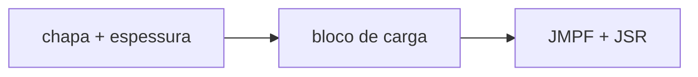

# glorystarHeader

## Visão geral

Cabeçalho de um programa GloryStar: bloco de carga, dados da chapa e salto para o início da trilha. Interno.

## Responsabilidades

- Declarar a chapa (`G2292`, `SHP`) e a espessura em micrômetros.
- Chamar os subprogramas do controlador por nome.

## Entradas e saídas

```ts
export function glorystarHeader(sheet: { length: number; width: number }, thickness: number): string[]
```

## Fluxo principal



## Tratamento de erros e casos-limite

Os subprogramas `inizio.cfs` e `Apa.cfs` pertencem ao controlador e não são definidos aqui.

## Exemplos

```ts
glorystarHeader({ length: 3000, width: 1500 }, 6)[2] // 'G2292,S1,X0,Y0,Z0,U3000,V1500,W1'
```

## Dependências e integrações

Nenhuma.
