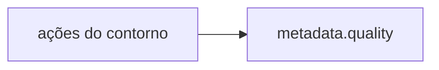

# glorystarQuality

## Visão geral

Lê o número de qualidade de um contorno nos metadados das ações. Interno ao dialeto da GloryStar.

## Responsabilidades

- Devolver a qualidade que escolhe o deslocamento de ferramenta e o modo do regulador.

## Entradas e saídas

```ts
export function contourQuality(contour: Contour): string | undefined
```

## Fluxo principal



## Tratamento de erros e casos-limite

Qualidade ausente ou vazia resulta em `undefined`; o processador acusa `PROCESS_SETTING_REQUIRED`.

## Exemplos

```ts
contourQuality(contour) // '1'
```

## Dependências e integrações

`../contourBlocks`.
