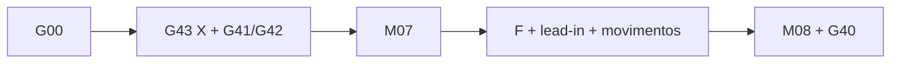

# hyperthermContour

## Visão geral

Escreve um contorno de um programa Hypertherm no formato do fabricante. Interno.

## Responsabilidades

- Escrever o valor de kerf (`G43 X`) e o lado (`G41`/`G42`) imediatamente antes de `M07`, e fechar o corte com `M08` e `G40`.
- Congelar o controle de altura no lead-in quando `m50n` estiver ligado.
- Escrever a palavra de avanço `F` uma vez por mudança em cada contorno, com o avanço de lead-in quando houver.
- Usar `M07 HS` e `M08 RT` conforme o contorno e os ajustes.
- Exigir o lado do kerf explícito nos metadados.

## Entradas e saídas

```ts
export function emitHyperthermContour(contour: Contour, context: HyperthermContourContext): readonly ValidationIssue[]
```

## Fluxo principal



## Tratamento de erros e casos-limite

`kerfSide` ausente gera `PROCESS_SETTING_REQUIRED`; `none` dispensa o kerf. `M15`/`M16` nunca são usados. O avanço é reescrito a cada contorno, como no pós do fabricante (o corte desliga o avanço ativo).

## Exemplos

```ts
emitHyperthermContour(contour, { writer, mapPoint, settings, dialect })
```

## Dependências e integrações

`../incrementalMoves`, `../../machine/messages`.
