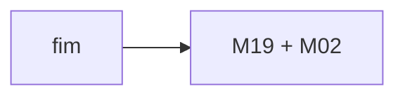

# hyperthermEnding

## Visão geral

Linhas finais de um programa Hypertherm. Interno.

## Responsabilidades

- Cancelar todas as estações (`M19`) e encerrar o programa (`M02`).

## Entradas e saídas

```ts
export function hyperthermEnding(): string[]
```

## Fluxo principal



## Tratamento de erros e casos-limite

Sem parâmetros.

## Exemplos

```ts
hyperthermEnding() // ['M19', 'M02']
```

## Dependências e integrações

Nenhuma.
