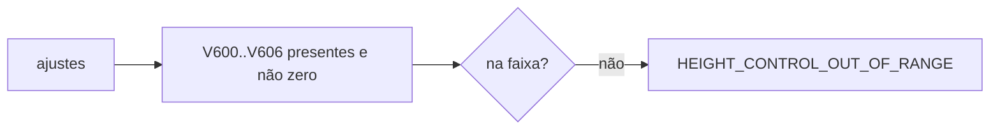

# hyperthermHeightControl

## Visão geral

Escreve as substituições opcionais do controle de altura (`G59 V600`..`V606`) e valida cada uma contra a faixa do fabricante. Interno.

## Responsabilidades

- Escrever só as variáveis presentes nos ajustes.
- Tratar zero em tensão, tempo de furo e alturas como "não definido", como o pós do fabricante.
- Rejeitar valor fora da faixa do fabricante, sem limitá-lo.
- Aplicar a faixa da altura de corte na unidade do programa.

## Entradas e saídas

```ts
export function hyperthermHeightControl(settings: ProcessSettings, units: Units): { lines: string[]; issues: ValidationIssue[] }
```

## Fluxo principal



## Tratamento de erros e casos-limite

Faixas: tensão 10 a 300 V, tempo de furo 0 a 9 s, fatores 50 a 400 %, altura de corte 0 a 25,4 mm (1 pol), atraso 0 a 5 s, re-detecção 0 a 10 s.

## Exemplos

```ts
hyperthermHeightControl({ arcVoltage: 127 }, 'mm').lines // ['G59 V600 F127']
```

## Dependências e integrações

`../../machine/messages`.
