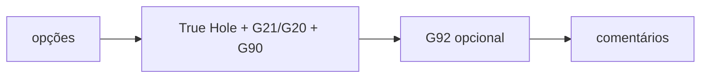

# hyperthermPreparation

## Visão geral

Linhas de preparação de um programa Hypertherm. Interno.

## Responsabilidades

- Escolher `G21` ou `G20` e o modo absoluto `G90`.
- Escrever `G92 X0 Y0` quando a configuração pede o preset de eixos.
- Escrever o comentário True Hole do fabricante, o de material e as pré-condições do controlador.

## Entradas e saídas

```ts
export function hyperthermPreparation(options: HyperthermPreparationOptions): string[]
```

## Fluxo principal



## Tratamento de erros e casos-limite

Sem comentário de material, a linha é omitida. O preset de eixos fica desligado por padrão: o pós do SigmaNEST não o escreve e o do ProNest sim.

## Exemplos

```ts
hyperthermPreparation({ units: 'mm', preconditions: [] }) // ['G21', 'G90']
```

## Dependências e integrações

Nenhuma.
