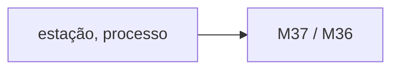

# hyperthermProcessSelect

## Visão geral

Linhas de seleção de estação e processo de um programa Hypertherm. Interno.

## Responsabilidades

- Escrever `M37 Tx` e `M36 Tx` com os números configurados.

## Entradas e saídas

```ts
export function hyperthermProcessSelect(station: number, process: number): string[]
```

## Fluxo principal



## Tratamento de erros e casos-limite

Sem tratamento especial: os números vêm da configuração.

## Exemplos

```ts
hyperthermProcessSelect(1, 1) // ['M37 T1', 'M36 T1']
```

## Dependências e integrações

Nenhuma.
