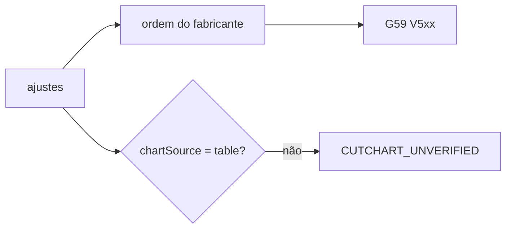

# hyperthermSelection

## Visão geral

Escreve a seleção do cut chart (`G59 V502`..`V507`) na ordem que o fabricante exige. Interno ao dialeto da Hypertherm.

## Responsabilidades

- Escrever tipo de tocha, material, corrente, gás, espessura e, quando existir, superfície de corte, na ordem de `chartOrder`.
- Acusar o parâmetro obrigatório ausente.
- Avisar quando os parâmetros não vieram de uma entrada de tabela.

## Entradas e saídas

```ts
export function hyperthermSelection(settings: ProcessSettings, chartOrder: readonly string[]): { lines: string[]; issues: ValidationIssue[] }
```

## Fluxo principal



## Tratamento de erros e casos-limite

O CNC recusa um valor `G59` ausente do cut chart dele; a biblioteca não vê esse cut chart, por isso o aviso.

## Exemplos

```ts
hyperthermSelection({ torchType: 34, materialType: 1 /* ... */ }, chartOrder).lines[0] // 'G59 V502 F34'
```

## Dependências e integrações

`../../machine/messages`.
