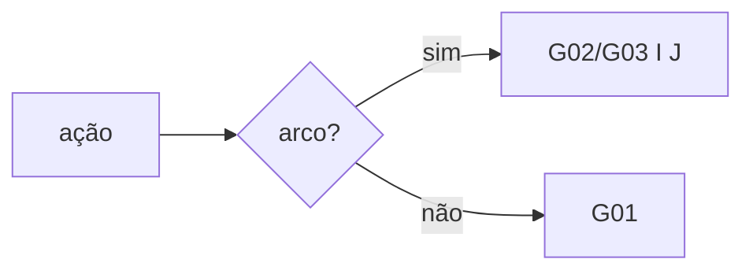

# incrementalMoves

## Visão geral

Escreve os movimentos de um contorno como retas `G01` e arcos `G02`/`G03` com centro incremental. Compartilhado pelos dialetos da Talvi e da Hypertherm. Interno.

## Responsabilidades

- Escrever retas como `G01` e arcos como `G02`/`G03` com `I`/`J` a partir do início do arco.
- Escrever um círculo completo como um único arco, no sentido do próprio arco.
- Escrever como reta arcos até `arcMinimumSweep` graus (zero mantém todos os arcos).
- Não escrever palavra de avanço.

## Entradas e saídas

```ts
export function emitIncrementalMoves(actions: readonly CutAction[], writer: GcodeWriter, mapPoint: (p: Point2D) => Point2D, dialect: { arcMinimumSweep: number }): void
```

## Fluxo principal



## Tratamento de erros e casos-limite

Centro e pontos são mapeados para o referencial da máquina antes de calcular `I`/`J`. Zero negativo nunca é escrito.

## Exemplos

```ts
emitIncrementalMoves(motions, writer, mapPoint, { arcMinimumSweep: 2 })
```

## Dependências e integrações

`./arcSweep`, `../gcode/writer`.
