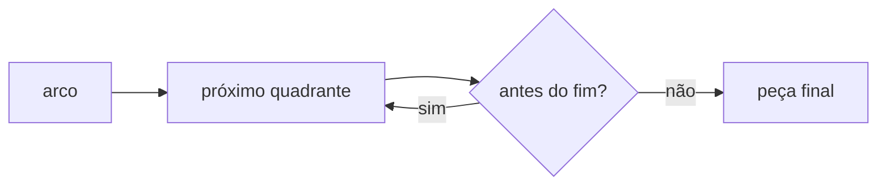

# splitArcAtQuadrants

## Visão geral

Divide um arco nos pontos de quadrante (0, 90, 180 e 270 graus) do círculo. Interno; usado pelo dialeto da GloryStar.

## Responsabilidades

- Percorrer o arco no sentido dado e cortar a cada quadrante cruzado.
- Encadear as peças e terminar exatamente em `end`.
- Devolver o arco inteiro quando ele cabe em um quadrante.

## Entradas e saídas

```ts
export function splitArcAtQuadrants(start: Point2D, end: Point2D, center: Point2D, clockwise: boolean): readonly ArcPiece[]
```

## Fluxo principal



## Tratamento de erros e casos-limite

Círculo completo gera quatro peças. Os pontos de quadrante usam seno e cosseno exatos para evitar ruído numérico.

## Exemplos

```ts
splitArcAtQuadrants({ x: 10, y: 0 }, { x: 10, y: 0 }, { x: 0, y: 0 }, false).length // 4
```

## Dependências e integrações

`./arcSweep`.
