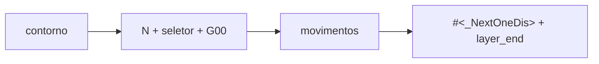

# talviContour

## Visão geral

Escreve o bloco de um contorno de um programa Talvi. Interno.

## Responsabilidades

- Seguir a ordem observada: número, seletor, rapid, `#<_openslag>=1`, `layer_start`, movimentos, distância ao próximo contorno e `layer_end`.
- Escrever a sentinela configurada no último contorno.
- Devolver os problemas de seletor.

## Entradas e saídas

```ts
export function emitTalviContour(contour: Contour, index: number, context: TalviContourContext): readonly ValidationIssue[]
```

## Fluxo principal



## Tratamento de erros e casos-limite

Seletor sem mapeamento vira comentário de rascunho e erro `PROCESS_MAPPING_MISSING`.

## Exemplos

```ts
emitTalviContour(contour, 0, { writer, mapPoint, mapping, dialect, isLast: false })
```

## Dependências e integrações

`./talviSelector`, `../incrementalMoves`, `../../gcode/formatNumber`.
