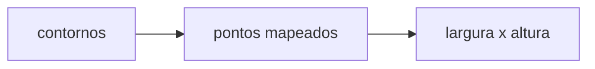

# talviExtents

## Visão geral

Mede o tamanho usado de um programa Talvi: a caixa delimitadora dos pontos de corte já no referencial da máquina. Interno.

## Responsabilidades

- Incluir os pontos de quadrante dos arcos para medir círculos pela extensão real.

## Entradas e saídas

```ts
export function talviExtents(contours: readonly Contour[], mapPoint: (p: Point2D) => Point2D): { width: number; height: number }
```

## Fluxo principal



## Tratamento de erros e casos-limite

Sem contornos devolve zero.

## Exemplos

```ts
talviExtents(contours, mapPoint).width
```

## Dependências e integrações

`../contourBlocks`, `../splitArcAtQuadrants`.
