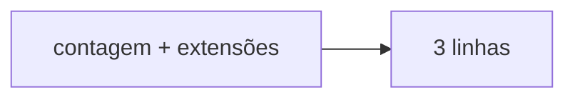

# talviHeader

## Visão geral

Linhas de comentário do cabeçalho de um programa Talvi. Interno.

## Responsabilidades

- Declarar o número de contornos, o tamanho usado e a quantidade de ferramentas.

## Entradas e saídas

```ts
export function talviHeader(contourCount: number, extents: { width: number; height: number }, sizeDecimals: number): string[]
```

## Fluxo principal



## Tratamento de erros e casos-limite

O tamanho é a caixa delimitadora dos pontos de corte mapeados.

## Exemplos

```ts
talviHeader(4, { width: 440, height: 1280 }, 3)
```

## Dependências e integrações

`../../gcode/formatNumber`.
