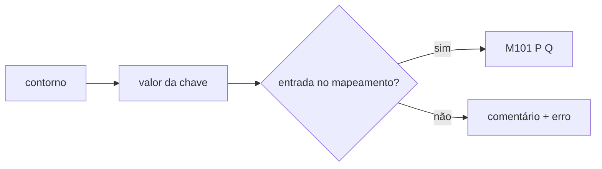

# talviSelector

## Visão geral

Monta a linha `M101 P Q` de um contorno a partir do mapeamento de processo aprovado. Interno ao dialeto da Talvi.

## Responsabilidades

- Ler o valor da chave do mapeamento nos metadados das ações do contorno.
- Omitir `Q` somente quando o mapeamento declara `when-undefined`.
- Nunca inventar seletor: sem entrada, escrever um comentário de rascunho e devolver o erro.

## Entradas e saídas

```ts
export function talviSelector(contour: Contour, mapping: ProcessMapping | undefined): { line: string; issues: readonly ValidationIssue[] }
```

## Fluxo principal



## Tratamento de erros e casos-limite

Mapeamento ausente, valor sem entrada ou `q` ausente com `omitQ: never` geram `PROCESS_MAPPING_MISSING`.

## Exemplos

```ts
talviSelector(contour, mapping).line // 'M101 P1 Q1'
```

## Dependências e integrações

`../contourBlocks`, `../../machine/messages`.
