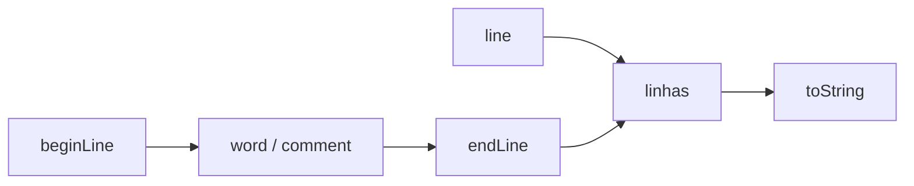

# writer

## Visão geral

Construtor determinístico de G-code por palavras. Dialetos o usam para escrever palavras de eixo, comentários e linhas brutas.

## Responsabilidades

- Escrever palavras `letra+valor` com precisão fixa e opção de zeros finais.
- Aceitar linhas brutas para macros e comandos que não seguem o formato de palavras.
- Renderizar com o fim de linha configurado.

## Entradas e saídas

```ts
class GcodeWriter {
  constructor(options?: { lineEnding?: '\n' | '\r\n'; precision?: number; trailingZeros?: boolean })
  beginLine(lineNumber?: number): this
  word(letter: string, value: number | string): this
  comment(text: string, style?: '(' | ';'): this
  line(text: string): this
  endLine(): this
  toString(): string
}
```

## Fluxo principal



## Tratamento de erros e casos-limite

Letra de palavra inválida e número não finito lançam `Error`. `toString` fecha a linha em construção.

## Exemplos

```ts
const w = new GcodeWriter({ precision: 4, trailingZeros: true })
w.beginLine().word('G', '01').word('X', 1.5).endLine() // G01 X1.5000
```

## Dependências e integrações

`./formatNumber`.
