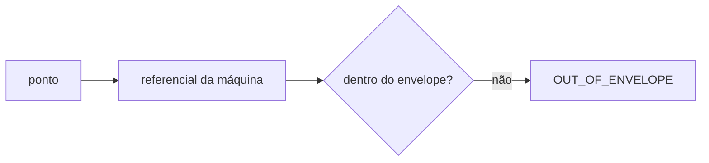

# envelopeIssues

## Visão geral

Compara cada ponto do plano, já no referencial da máquina, com o envelope de trabalho confirmado. Interno: usado pelos processadores de dialeto.

## Responsabilidades

- Mapear cada ponto com `mapToMachineFrame`.
- Relatar o primeiro ponto fora por ação e por eixo, com contorno, eixo e limite.
- Relatar uma vez por eixo quando a chapa não cabe no envelope.

## Entradas e saídas

```ts
export function envelopeIssues(plan: CutPlan, configuration: MachineConfiguration, sheet: { width: number; height: number }): readonly ValidationIssue[]
```

## Fluxo principal



## Tratamento de erros e casos-limite

Usa `EPSILON` nas comparações. Os limites suaves do controlador nunca são lidos. Plano vazio não gera problema de ação.

## Exemplos

```ts
const issues = envelopeIssues(plan, configuration, { width: 1500, height: 3000 })
```

## Dependências e integrações

`../../config`, `./mapToMachineFrame`, `./messages`.
