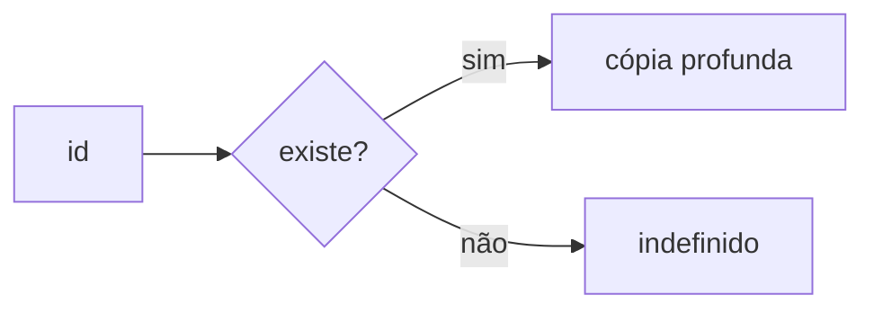

# getMachineConfiguration

## Visão geral

Obtém uma configuração de máquina embutida por identificador, como cópia profunda.

## Responsabilidades

- Devolver uma cópia que não altera os dados embutidos.
- Devolver `undefined` para identificador desconhecido, sem usar outra máquina no lugar.

## Entradas e saídas

```ts
export function getMachineConfiguration(configurationId: string): MachineConfiguration | undefined
```

## Fluxo principal



## Tratamento de erros e casos-limite

Identificador desconhecido não lança exceção.

## Exemplos

```ts
const talvi = getMachineConfiguration('talvi-6000w')
```

## Dependências e integrações

`./builtInConfigurations`.
