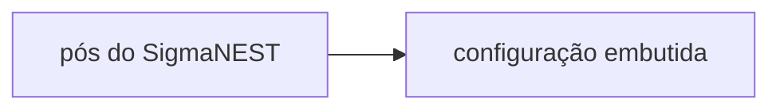

# gloryStarGs3015

## Visão geral

Dados da configuração embutida da laser GloryStar GS3015, cada valor com sua fonte e classificação. Nenhum valor é aprovado.

## Responsabilidades

- Registrar o dialeto observado no pós do SigmaNEST (limiares de cabeça, sensor de altura, quadrantes).
- Registrar o conflito de tamanho de mesa e as dependências ausentes.

## Entradas e saídas

```ts
export const gloryStarGs3015Configuration: MachineConfiguration
```

## Fluxo principal



## Tratamento de erros e casos-limite

Não há programa real da máquina: as evidências vêm do pós, por isso nada é aprovado.

## Exemplos

```ts
const copy = getMachineConfiguration('glorystar-gs3015')
```

## Dependências e integrações

`./types`, `./valueSource`.
