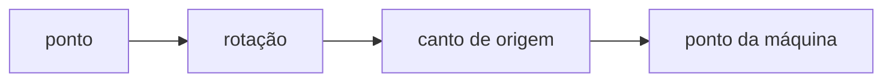

# mapToMachineFrame

## Visão geral

Converte um ponto do referencial do nesting (zero no canto inferior esquerdo da chapa) para o referencial da máquina declarado na configuração.

## Responsabilidades

- Girar a chapa no sentido anti-horário em torno do canto inferior esquerdo.
- Deslocar o zero para o canto da mesa declarado.
- Não alterar o ponto de entrada.

## Entradas e saídas

```ts
export function mapToMachineFrame(point: Point2D, sheet: { width: number; height: number }, frame: MachineFrame): Point2D
```

## Fluxo principal



## Tratamento de erros e casos-limite

Coordenada não finita lança `RangeError`; a geometria já é validada antes da emissão (`GEOMETRY_INVALID`).

## Exemplos

```ts
mapToMachineFrame({ x: 100, y: 100 }, { width: 1500, height: 3000 }, { rotationDegrees: 0, origin: 'bottom-right' }) // { x: -1400, y: 100 }
```

## Dependências e integrações

`../../types` (`Point2D`) e `./types`.
