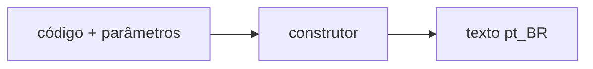

# messages

## Visão geral

Único módulo que constrói os textos em português (pt_BR) dos problemas de configuração, dialeto, tabela de corte e receitas. Códigos e nomes de parâmetro ficam em inglês.

## Responsabilidades

- Ter um construtor de mensagem para cada código de problema.
- Interpolar caminho, contorno, eixo, faixa e demais valores.
- Não ser exportado pelo barrel público.

## Entradas e saídas

```ts
export type MessageCode = 'CONFIG_FIELD_MISSING' | 'UNAPPROVED_VALUE' | /* ... */ 'RECIPE_FIELD_MISSING'
export const MESSAGE_CODES: readonly MessageCode[]
export function message(code: MessageCode, params?: Record<string, string | number | undefined>): string
```

## Fluxo principal



## Tratamento de erros e casos-limite

Parâmetros ausentes aparecem como `undefined` no texto; quem chama passa os que o código usa.

## Exemplos

```ts
message('OUT_OF_ENVELOPE', { contour: 'c-1', axis: 'X', value: 5, bound: 0 })
```

## Dependências e integrações

Nenhuma.
