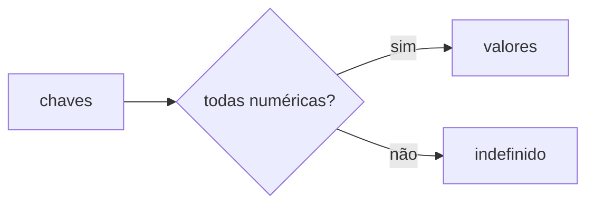

# numericDialect

## Visão geral

Lê vários parâmetros numéricos de dialeto de uma vez. Interno aos processadores.

## Responsabilidades

- Devolver os valores por nome ou `undefined` se algum faltar.

## Entradas e saídas

```ts
export function numericDialect<K extends string>(configuration: MachineConfiguration, keys: readonly K[]): Record<K, number> | undefined
```

## Fluxo principal



## Tratamento de erros e casos-limite

Quando devolve `undefined` o emissor devolve texto vazio e `releaseIssues` acusa o campo ausente.

## Exemplos

```ts
numericDialect(configuration, ['lastDistance', 'distanceDecimals'])
```

## Dependências e integrações

`./dialectValue`.
