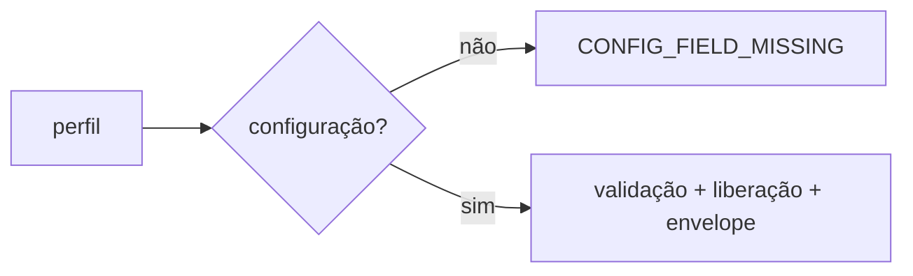

# processorIssues

## Visão geral

Problemas comuns a todos os processadores de dialeto: configuração, porta de liberação e envelope. Interno.

## Responsabilidades

- Acusar `CONFIG_FIELD_MISSING` quando o perfil não traz configuração.
- Reunir validação da configuração, valores não aprovados e envelope.

## Entradas e saídas

```ts
export function processorIssues(processorId: string, plan: CutPlan, profile: MachineProfile): readonly ValidationIssue[]
```

## Fluxo principal



## Tratamento de erros e casos-limite

Sem configuração nada mais é verificado, e os emissores devolvem texto vazio.

## Exemplos

```ts
processorIssues('talvi-6000w', plan, profile)
```

## Dependências e integrações

`./validateMachineConfiguration`, `./releaseIssues`, `./envelopeIssues`.
