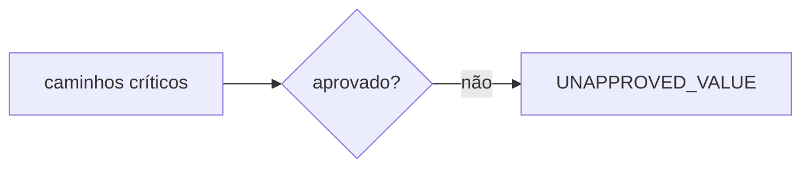

# releaseIssues

## Visão geral

Porta de liberação: gera um erro para cada valor crítico ausente ou ainda não aprovado. Interno.

## Responsabilidades

- Percorrer os caminhos críticos do processador.
- Emitir `UNAPPROVED_VALUE` para valor não aprovado e `CONFIG_FIELD_MISSING` para valor ausente.

## Entradas e saídas

```ts
export function releaseIssues(processorId: string, configuration: MachineConfiguration): readonly ConfigurationIssue[]
```

## Fluxo principal



## Tratamento de erros e casos-limite

O programa continua sendo gerado para revisão; só a liberação é bloqueada. Valores não críticos são ignorados.

## Exemplos

```ts
const blocking = releaseIssues('talvi-6000w', configuration)
```

## Dependências e integrações

`./criticalPaths`, `./messages`.
