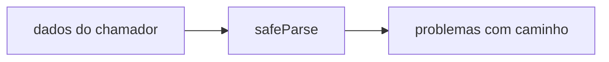

# schemas

## Visão geral

Esquema Zod de `MachineConfiguration`, usado na borda para validar a configuração que o chamador entrega. Mesma exceção de Zod da fronteira ERP (ADR-0002).

## Responsabilidades

- Validar a estrutura e os tipos da configuração.
- Exigir fonte e referência em cada valor com evidência.
- Deixar as regras entre campos para `validateMachineConfiguration`.

## Entradas e saídas

```ts
export const machineConfigurationSchema: z.ZodObject<...>
```

## Fluxo principal



## Tratamento de erros e casos-limite

Problemas do Zod são convertidos em `ConfigurationIssue` por `validateMachineConfiguration`; o esquema nunca lança.

## Exemplos

```ts
machineConfigurationSchema.safeParse(configuration).success
```

## Dependências e integrações

`zod`.
