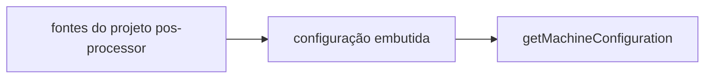

# talvi6000w

## Visão geral

Dados da configuração embutida da Talvi 6000 W, cada valor com sua fonte e classificação. Nenhum valor é aprovado: o programa sai para revisão, não para liberação.

## Responsabilidades

- Registrar envelope, referencial, formato numérico e parâmetros do dialeto observados nos programas reais.
- Registrar o que é só inferido (sentinela, rotação, deslocamento).
- Não trazer mapeamento de processo: ele é aprovado por uma pessoa.

## Entradas e saídas

```ts
export const talvi6000wConfiguration: MachineConfiguration
```

## Fluxo principal



## Tratamento de erros e casos-limite

Os limites suaves do controlador (X -1525..0, Y 0..3070) ficam só na nota do envelope.

## Exemplos

```ts
const copy = getMachineConfiguration('talvi-6000w')
```

## Dependências e integrações

`./types`.
