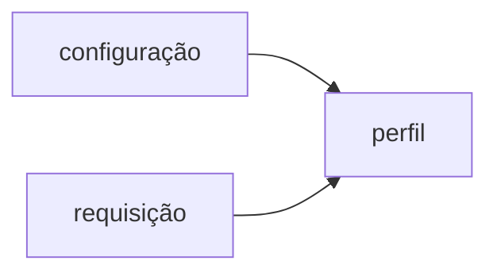

# toMachineProfile

## Visão geral

Transforma uma configuração de máquina e os dados de uma requisição em um `MachineProfile` para `generateMachineProgram`.

## Responsabilidades

- Copiar identidade, unidades e processador da configuração.
- Anexar a configuração ao perfil sem alterá-la.
- Aceitar revisão, limite de avanço, ajustes de processo e saída revisada da requisição.

## Entradas e saídas

```ts
export function toMachineProfile(configuration: MachineConfiguration, request: ProfileRequest): MachineProfile
```

## Fluxo principal



## Tratamento de erros e casos-limite

Uma chapa inválida passa adiante; `validateMachineProfile` a rejeita.

## Exemplos

```ts
const profile = toMachineProfile(config, { sheet: { width: 1500, height: 3000, margin: 0 } })
```

## Dependências e integrações

`./types`, `../types`.
