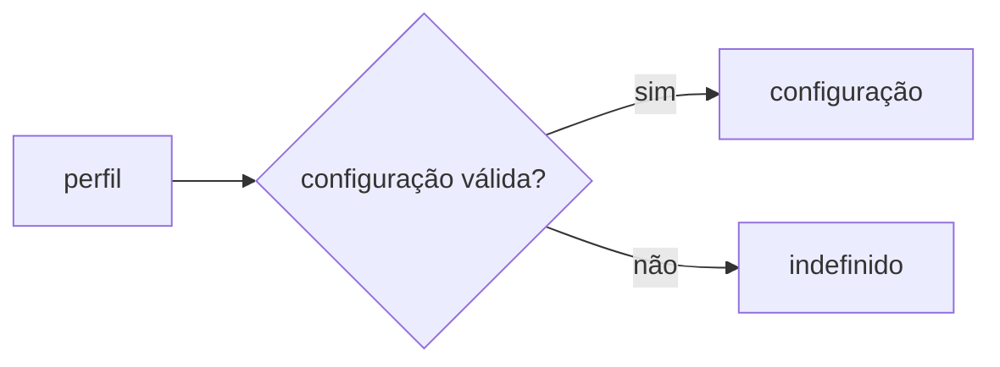

# usableConfiguration

## Visão geral

Devolve a configuração de um perfil quando ela pode guiar um emissor. Interno.

## Responsabilidades

- Evitar que um emissor lance exceção com configuração ausente ou inválida.

## Entradas e saídas

```ts
export function usableConfiguration(profile: MachineProfile): MachineConfiguration | undefined
```

## Fluxo principal



## Tratamento de erros e casos-limite

O orquestrador emite antes de validar; os problemas são relatados pelo `validate` do processador.

## Exemplos

```ts
const configuration = usableConfiguration(profile)
if (!configuration) return ''
```

## Dependências e integrações

`./validateMachineConfiguration`.
