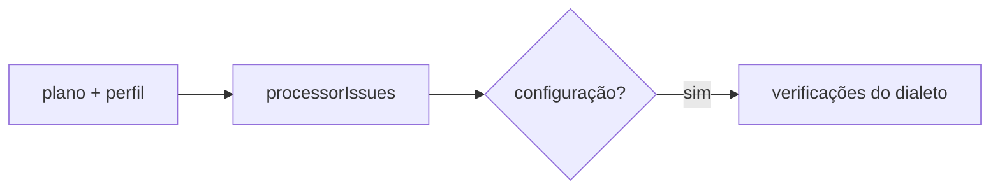

# validateDialect

## Visão geral

Valida um plano para um processador de dialeto: problemas comuns mais os do próprio dialeto. Interno.

## Responsabilidades

- Reunir configuração, porta de liberação e envelope.
- Chamar as verificações do dialeto só quando há configuração.

## Entradas e saídas

```ts
export function validateDialect(processorId, plan, profile, dialect: (configuration: MachineConfiguration) => readonly ValidationIssue[]): readonly ValidationIssue[]
```

## Fluxo principal



## Tratamento de erros e casos-limite

Sem configuração só `CONFIG_FIELD_MISSING` é devolvido.

## Exemplos

```ts
validateDialect('talvi-6000w', plan, profile, (configuration) => [])
```

## Dependências e integrações

`./processorIssues`.
