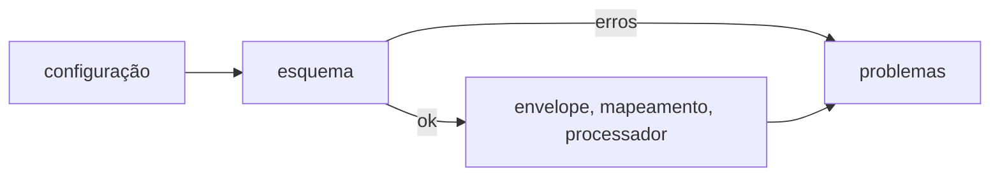

# validateMachineConfiguration

## Visão geral

Valida uma configuração de máquina e devolve todos os problemas com o caminho do valor que falhou.

## Responsabilidades

- Validar estrutura, fonte e valores com o esquema Zod.
- Verificar envelope, mapeamento de processo e processador registrado.
- Nunca lançar exceção para dados inválidos.

## Entradas e saídas

```ts
export function validateMachineConfiguration(configuration: MachineConfiguration): readonly ConfigurationIssue[]
```

## Fluxo principal



## Tratamento de erros e casos-limite

Entrada nula ou sem campos gera problemas de campo ausente. `CONFIG_UNKNOWN_PROCESSOR` exige o registro carregado pelo barrel do pós-processamento.

## Exemplos

```ts
const issues = validateMachineConfiguration(configuration)
if (issues.length > 0) console.log(issues[0].path)
```

## Dependências e integrações

`../registry`, `./schemas`, `./messages`.
