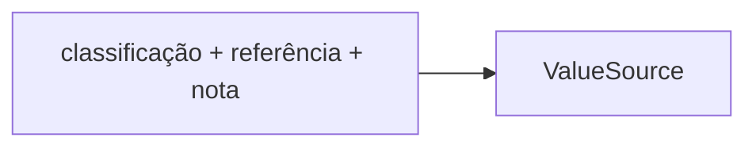

# valueSource

## Visão geral

Constrói a evidência (`ValueSource`) de um valor de configuração. Interno às configurações embutidas.

## Responsabilidades

- Montar classificação, referência e nota opcional.

## Entradas e saídas

```ts
export function valueSource(classification: ValueClassification, reference: string, note?: string): ValueSource
```

## Fluxo principal



## Tratamento de erros e casos-limite

Nenhum tratamento: os dados são constantes das configurações.

## Exemplos

```ts
valueSource('observed', 'Talvi_6000W.pst:411')
```

## Dependências e integrações

`./types`.
