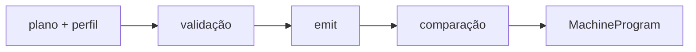

# process

## Visão geral

Orquestração da geração de programas: resolve o processador pela identidade exata, valida, emite, compara com a saída revisada e bloqueia a liberação.

## Responsabilidades

- Validar o perfil, o plano e o processador antes de emitir.
- Comparar o texto canônico com a saída revisada.
- Informar extensão e fim de linha da configuração, quando o perfil traz uma.

## Entradas e saídas

```ts
export function generateMachineProgram(plan: CutPlan, profile: MachineProfile): MachineProgram
```

## Fluxo principal



## Tratamento de erros e casos-limite

Qualquer erro ou divergência bloqueia a liberação. O campo `output` só existe quando o perfil traz configuração.

## Exemplos

```ts
const program = generateMachineProgram(plan, profile)
program.releasable
```

## Dependências e integrações

`./registry`, `./validate`, `./linearize`, `./canonicalize`.
