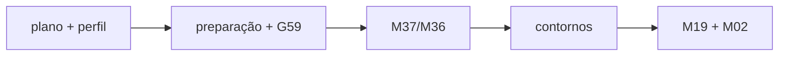

# hypertherm-edge-pro-hpr400xda

## Visão geral

Processador da plasma Hypertherm EDGE Pro HPR400XDa no formato de programa do EDGE Connect (Programmer Reference 809550 rev. 6).

## Responsabilidades

- Escrever preparação, seleção do cut chart na ordem do fabricante, substituições `V6xx` e seleção de estação e processo.
- Escrever cada contorno com kerf imediatamente antes de `M07`, `M08` e `G40`, e fechar com `M19` e `M02`.
- Validar as faixas do controle de altura e exigir os ajustes obrigatórios.
- Bloquear a liberação de valores críticos não aprovados.

## Entradas e saídas

```ts
export const hyperthermEdgeProHpr400xda: PostProcessor // id 'hypertherm-edge-pro-hpr400xda', revisão 'edge-connect-809550-6'
```

## Fluxo principal



## Tratamento de erros e casos-limite

Sem `profile.configuration` ou com configuração inválida, `emit` devolve texto vazio. Ajustes digitados à mão geram o aviso `CUTCHART_UNVERIFIED`, que não bloqueia a liberação.

## Exemplos

```ts
generateMachineProgram(plan, toMachineProfile(configuration, { sheet, processSettings, expectedOutput }))
```

## Dependências e integrações

`../dialects/hypertherm/*`, `../machine/*`.
