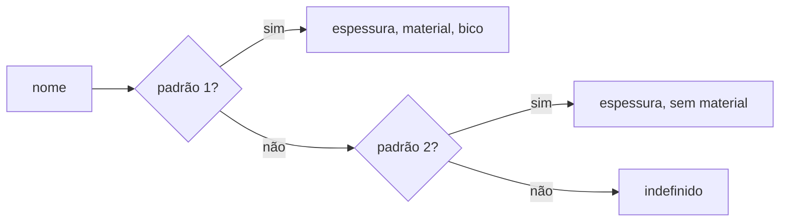

# parseTalviRecipeName

## Visão geral

Lê espessura, material e bico do nome de um arquivo de ferramenta da Talvi. Interno.

## Responsabilidades

- Reconhecer os dois padrões de nome (`<espessura>mm <material> <s|d><bico>` e `<bico>双<espessura>mm`).
- Normalizar o material; o segundo padrão não traz material.
- Nunca adivinhar um nome que não se encaixa.

## Entradas e saídas

```ts
export function parseTalviRecipeName(name: string): { thicknessMm: number; material: TalviMaterial | null; nozzle: string } | undefined
```

## Fluxo principal



## Tratamento de erros e casos-limite

Material desconhecido no primeiro padrão resulta em `undefined`.

## Exemplos

```ts
parseTalviRecipeName('12mm inox s3.5.HSTool') // { thicknessMm: 12, material: 'stainless-steel', nozzle: 's3.5' }
```

## Dependências e integrações

`./types`.
