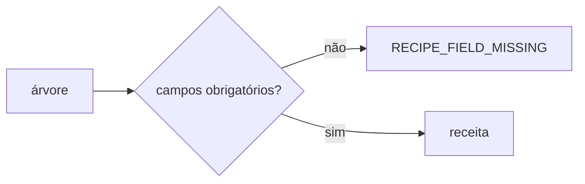

# recipeFromTree

## Visão geral

Monta uma receita da Talvi a partir do arquivo de ferramenta já lido. Interno.

## Responsabilidades

- Exigir os campos de corte obrigatórios e o número da ferramenta.
- Listar só as etapas de perfuração abertas.
- Incluir os parâmetros de lead apenas quando habilitados.

## Entradas e saídas

```ts
export function recipeFromTree(file: string, name: ParsedRecipeName, tree: XmlNode): { recipe: TalviRecipe } | { issue: RecipeIssue }
```

## Fluxo principal



## Tratamento de erros e casos-limite

O primeiro campo obrigatório ausente é relatado pelo nome da tag. Campos opcionais ausentes ficam fora da receita.

## Exemplos

```ts
const result = recipeFromTree(name, parsed, readFlatXml(text))
```

## Dependências e integrações

`./readFlatXml`, `./types`, `../machine/messages`.
