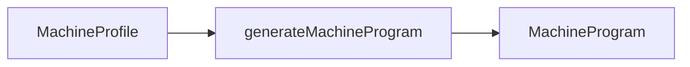

# types

## Visão geral

Tipos públicos do pós-processamento modular: perfil de máquina, processador, programa gerado e problemas de validação.

## Responsabilidades

- Definir o contrato de `MachineProfile`, `PostProcessor` e `MachineProgram`.
- Aceitar de forma aditiva a configuração de máquina (`configuration`) e os metadados de saída (`output`).

## Entradas e saídas

```ts
interface MachineProfile { /* ... */ configuration?: MachineConfiguration }
interface MachineProgram { /* ... */ output?: { extension: string; lineEnding: 'lf' | 'crlf' } }
```

## Fluxo principal



## Tratamento de erros e casos-limite

Campos novos são opcionais: os processadores genéricos e o EDGE Connect não mudam.

## Exemplos

```ts
const profile: MachineProfile = toMachineProfile(configuration, request)
```

## Dependências e integrações

`./machine/types` e `../cutPath`.
