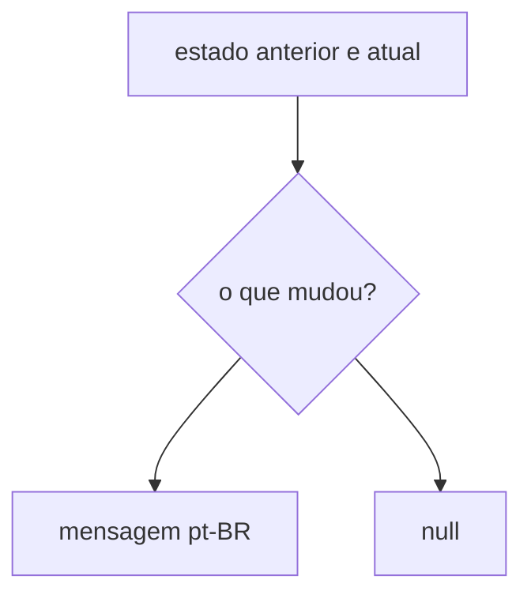

# announcementFor

## Visão geral

Escolhe o texto anunciado na região `role="status"` quando o estado da revisão muda. Módulo interno.

## Responsabilidades

- Anunciar troca de chapa, queda para a vista estática, início e pausa da reprodução, seleção, remoção da seleção e busca por ação.
- Manter silêncio durante a reprodução contínua.

## Entradas e saídas

```ts
export function announcementFor(scene: ReviewScene, previous: ReviewState | null, state: ReviewState): string | null
```

## Fluxo principal



## Tratamento de erros e casos-limite

O primeiro estado não gera anúncio.

## Exemplos

```ts
announcementFor(scene, previous, state) // "Ação 5 de 11"
```

## Dependências e integrações

`./inspect`, `./messages` e `./types`.
