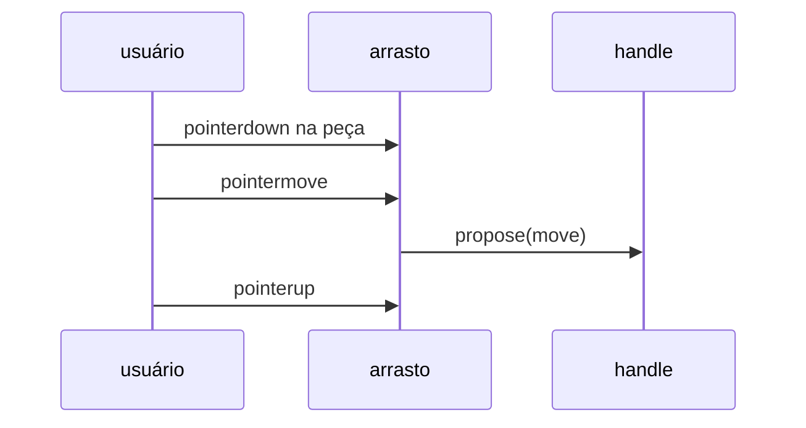

# review/attachDrag

## Visão geral

Arrasto de peças no modo de edição: pressionar seleciona, mover propõe uma posição a cada passo e soltar mantém a proposta pendente.

## Responsabilidades

- Usar o renderizador ativo para converter o ponteiro em coordenadas da chapa.
- Não confirmar nada: a confirmação é sempre explícita.

## Entradas e saídas

```ts
export function attachDrag(deps: DragDeps): void
```

## Fluxo principal



## Tratamento de erros e casos-limite

Fora do modo de edição ou sem peça sob o ponteiro, nada acontece.

## Exemplos

```ts
attachDrag({ view, scene, controller, renderers, latest, handle, editing })
```

## Dependências e integrações

`./pick` e `./types`.
