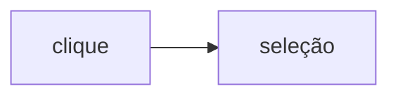

# attachPointer

## Visão geral

Seleciona a peça ou ação sob o clique; clicar de novo no mesmo ponto passa ao próximo item sobreposto. Módulo interno.

## Responsabilidades

- Converter o ponteiro em coordenadas da chapa pelo renderizador ativo e usar `pickAt` com tolerância de 6 px.

## Entradas e saídas

```ts
export function attachPointer(view, scene, controller, renderers, latest): void
```

## Fluxo principal



## Tratamento de erros e casos-limite

Sem estado recebido ainda, o clique é ignorado.

## Exemplos

```ts
attachPointer(view, scene, controller, renderers, latest)
```

## Dependências e integrações

`./pick` e `./startRenderers`.
