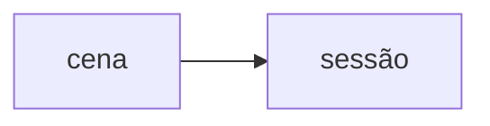

# attachSession

## Visão geral

Inicia a sessão interativa de uma revisão montada: renderizadores, controlador, painéis, ponteiro, teclado e sincronização. Módulo interno.

## Responsabilidades

- Compor os módulos da montagem e devolver o controlador com uma função de encerramento.
- Aceitar o estado de uma sessão anterior (chapa, viewport e seleção) e devolver também os renderizadores, para a edição reconstruir a sessão sem perder o contexto.

## Entradas e saídas

```ts
export async function attachSession(root, view, scene, options): Promise<{ controller: ReviewController; stop(): void }>
```

## Fluxo principal



## Tratamento de erros e casos-limite

O encerramento cancela a assinatura e descarta o controlador.

## Exemplos

```ts
const session = await attachSession(root, view, scene, options)
```

## Dependências e integrações

`./startRenderers`, `./controller`, `./buildPanels`, `./attachPointer`, `./bindState` e `./domClock`.
