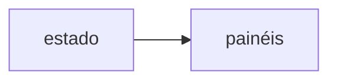

# bindState

## Visão geral

Mantém painéis, anúncios, seletor de chapa e atributos da raiz sincronizados com o estado do controlador. Módulo interno.

## Responsabilidades

- Trocar o renderizador ativo para o estático após uma falha gráfica.
- Substituir o painel de avisos quando os avisos mudam.

## Entradas e saídas

```ts
export function bindState(root, scene, controller, panels, renderers, latest): { unsubscribe(): void }
```

## Fluxo principal



## Tratamento de erros e casos-limite

Anúncios só são escritos quando mudam.

## Exemplos

```ts
const subscription = bindState(root, scene, controller, panels, renderers, latest)
```

## Dependências e integrações

`./announce`, `./noticesPanel` e `./buildPanels`.
