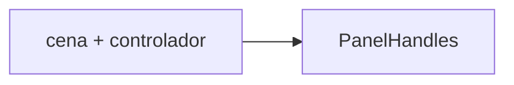

# buildPanels

## Visão geral

Acrescenta à raiz os painéis interativos: seletor de chapa, controles, atalhos, vista, inspetor, avisos e região de status. Módulo interno.

## Responsabilidades

- Tornar a vista focável e ligar o teclado ao controlador.
- Devolver os manipuladores usados para sincronizar com o estado.

## Entradas e saídas

```ts
export function buildPanels(root: HTMLElement, view: HTMLElement, scene: ReviewScene, controller: ReviewController): PanelHandles
```

## Fluxo principal



## Tratamento de erros e casos-limite

O inspetor só aparece quando há peças ou ações inspecionáveis.

## Exemplos

```ts
const panels = buildPanels(root, view, scene, controller)
```

## Dependências e integrações

Os painéis `controlsPanel`, `inspectorPanel`, `noticesPanel`, `shortcutsPanel`, `sheetSwitcher` e `./messages`.
