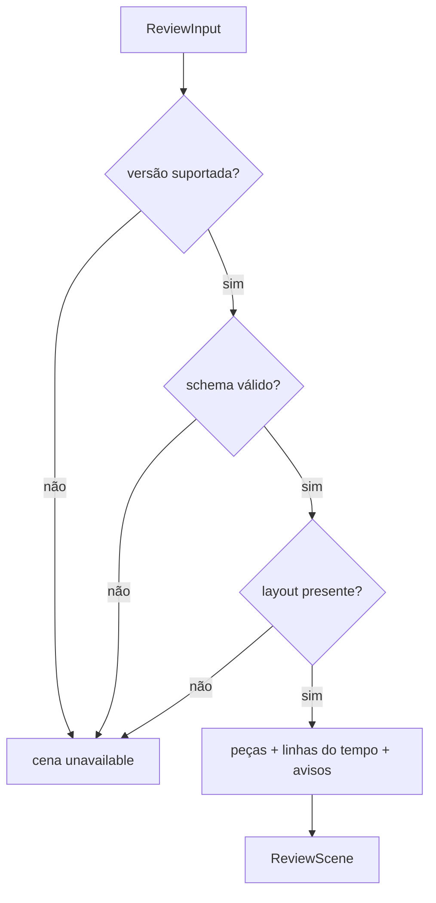

# buildReviewScene

## Visão geral

Constrói a cena imutável de revisão a partir de um artefato do contrato ERP, de um `CutLayout`
opcional e de um `CutPlanResult` opcional. Função pura e determinística.

## Responsabilidades

- Verificar a versão do contrato e validar o artefato com o schema Zod existente.
- Converter avisos, rejeições, itens não alocados e problemas de planejamento em `ReviewNotice`.
- Montar chapas, peças (`placed` ou `flagged`), linhas do tempo, resumo e capacidades.
- Nunca recalcular layout, sequência ou métricas.

## Entradas e saídas

```ts
export function buildReviewScene(input: ReviewInput): ReviewScene
```

## Fluxo principal



## Tratamento de erros e casos-limite

Não lança exceção para resultados esperados. Sem plano de corte, a revisão estática continua e
`NO_CUT_PLAN` explica a indisponibilidade. Ação de comprimento zero (exceto `pierce` e `end`)
gera `DEGENERATE_ACTION` e permanece na ordem.

## Exemplos

```ts
const scene = buildReviewScene({ artifact, layout, cutPlan })
scene.notices.map((notice) => notice.code)
```

## Dependências e integrações

`../erp/schemas`, `../erp/types`, `../cutPath/types`, `./buildTimeline`, `./linkParts`,
`./resolvePlacements` e `./messages`.
