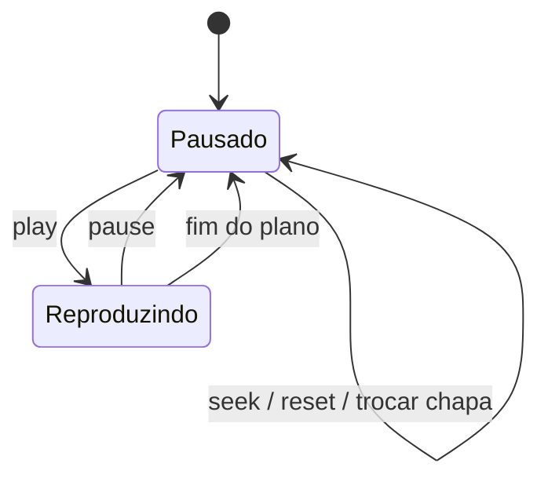

# createReviewController

## Visão geral

Controlador de uma sessão de revisão: reprodução, busca, troca de chapa e queda do renderizador acelerado para o estático.

## Responsabilidades

- Manter o estado observável (`state$`) e emitir só quando algo muda.
- Receber o tempo apenas pelo relógio injetado; nunca iniciar a reprodução sozinho.
- Trocar para o renderizador estático ao receber falha gráfica, mantendo posição e seleção.
- Executar comandos de teclado (`handleKey`) e manter a vista (`pan`, `zoomBy`, `resetViewport`).
- Manter a seleção (`select`, `moveSelection`, `seekToSelectedAction`); só aceita peças e ações que existem na chapa atual e a limpa ao trocar de chapa.
- Restaurar chapa, viewport e seleção de uma sessão anterior quando `initial` é informado.

## Entradas e saídas

```ts
export function createReviewController(options: ReviewControllerOptions): ReviewController
```

## Fluxo principal



## Tratamento de erros e casos-limite

Chapa desconhecida é ignorada. Índice de ação fora do intervalo é limitado. Sem plano de corte, `play` não faz nada. Falha gráfica sem renderizador de contingência deixa a vista sem desenho, com aviso.

## Exemplos

```ts
controller.seekToAction(12)
controller.play()
```

## Dependências e integrações

`rxjs`, `./sameState`, `./keyMap`, `./stateAt`, `./nextPierce`, `./positionAtDistance`, `./distanceAtPosition`, `./graphicsNotice`.
