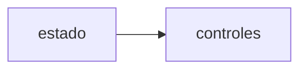

# controlsPanel

## Visão geral

Controles de reprodução rotulados: reproduzir/pausar, reiniciar, próxima perfuração, velocidade, posição e campo "Ir para a ação".

## Responsabilidades

- Delegar toda ação ao controlador, inclusive velocidade por `handleKey`.
- Sincronizar os controles com cada estado por `update`.

## Entradas e saídas

```ts
export function controlsPanel(doc: Document, controller: ReviewController, actionCount: (sheetId: string) => number): ControlsHandle
```

## Fluxo principal



## Tratamento de erros e casos-limite

Todos os controles são alcançáveis por Tab.

## Exemplos

```ts
const controls = controlsPanel(doc, controller, actionCount)
```

## Dependências e integrações

`./messages` e `./types`.
