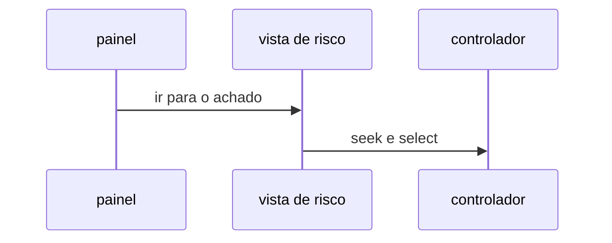

# review/createRiskView

## Visão geral

Liga o painel de risco à reprodução: as peças livres, o calor acumulado e os marcadores seguem a posição, e o botão de um marcador vai até o achado e seleciona o que ele diz respeito.

## Responsabilidades

- Seguir a posição do controlador da sessão atual, inclusive depois de uma reconstrução.
- Mostrar o calor máximo do instante em texto.
- Desenhar as camadas pelo hub de overlay.

## Entradas e saídas

```ts
export function createRiskView(doc: Document, hub: OverlayHub, current: () => PopulatedReview | null): RiskView
```

## Fluxo principal



## Tratamento de erros e casos-limite

Um resultado desatualizado remove as camadas até o recálculo.

## Exemplos

```ts
const view = createRiskView(document, hub, () => populated)
view.update(result, false, request)
```

## Dependências e integrações

`./riskPanel`, `./riskPlayback` e `./overlayHub`.
