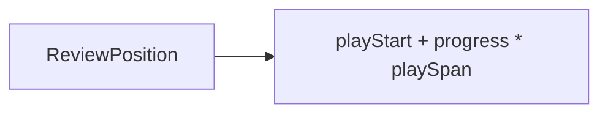

# distanceAtPosition

## Visão geral

Converte uma posição de revisão em distância no eixo de reprodução. Módulo interno.

## Responsabilidades

- Servir de inverso de `positionAtDistance` para buscar uma posição durante a reprodução.

## Entradas e saídas

```ts
export function distanceAtPosition(timeline: ReviewTimeline, position: ReviewPosition): number
```

## Fluxo principal



## Tratamento de erros e casos-limite

Posição final devolve o total; progresso é limitado a [0, 1].

## Exemplos

```ts
distanceAtPosition(timeline, { sheetId: "sheet-1", actionIndex: 3, progress: 0.5 })
```

## Dependências e integrações

`./types`.
