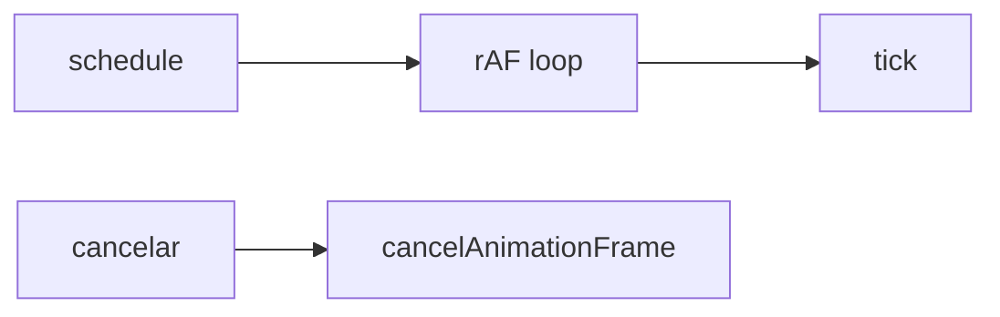

# createAnimationClock

## Visão geral

Relógio de reprodução baseado em quadros de animação do navegador. Módulo interno.

## Responsabilidades

- Fornecer `now` e agendar ticks por `requestAnimationFrame`.

## Entradas e saídas

```ts
export function createAnimationClock(view: Window): ReviewClock
```

## Fluxo principal



## Tratamento de erros e casos-limite

O cancelamento interrompe o laço.

## Exemplos

```ts
const clock = createAnimationClock(window)
```

## Dependências e integrações

`./types`.
